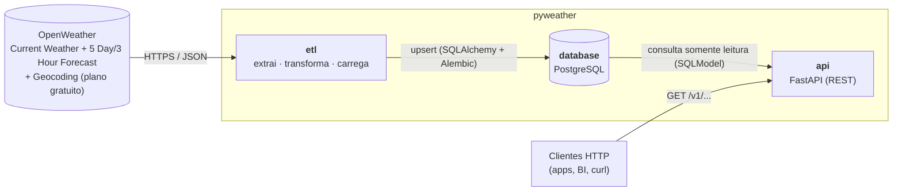

# pyweather

Plataforma para **obter, armazenar e servir dados climáticos de uma cidade** a partir da API pública
da [OpenWeather](https://openweathermap.org/api) — **somente APIs do plano gratuito** (Current Weather e 5 Day / 3 Hour Forecast).

- **ETL** (`services/etl`): extrai da OpenWeather, transforma em entidades de domínio e carrega em **PostgreSQL**.
- **API RESTful** (`services/api`): **FastAPI** com filtros sobre os dados extraídos; Swagger/OpenAPI **em português**.
- **Python 3.14 + uv**, **DDD** (arquitetura hexagonal), testes com **cobertura ≥ 80 %**, imagens Docker `gntech/pyweather-<serviço>:latest`.

<!-- mmd:arquitetura-contexto -->

<!-- /mmd -->

## Início rápido

```bash
echo "OPENWEATHER_API_KEY=sua-chave" > infra/docker/etl/.env.local   # não versionado
make up                                                              # PostgreSQL + ETL + API
open http://localhost:8000/docs                                      # Swagger UI
```

`make help` lista todos os comandos (dependências, qualidade, execução local, smoke tests, Docker, docs).

Teste de sanidade de ponta a ponta (stack completa em contêineres + collection Postman, sem chave da OpenWeather):

```bash
make smoke
```

## Documentação

| # | Seção | Conteúdo |
|---|-------|----------|
| 1 | [Apresentação, preliminares e início rápido](docs/md/01-apresentacao.md) | Ferramentas e versões, pré-requisitos, primeiros passos |
| 2 | [Arquitetura e design pattern](docs/md/02-arquitetura.md) | Contexto, camadas DDD, decisões, implantação |
| 3 | [Modelagem de domínios e entidades](docs/md/03-dominio.md) | Entidades, objetos de valor, portas, modelo relacional |
| 4 | [Casos de uso](docs/md/04-casos-de-uso.md) | Atores, UC-01 a UC-10 |
| 5 | [Sequências](docs/md/05-sequencias.md) | ETL, tratamento de falhas, consulta pela API |
| 6 | [Referência da API](docs/md/06-api.md) | Endpoints, filtros, erros, exemplos |
| 7 | [Desenvolvimento e operação](docs/md/07-desenvolvimento.md) | Estrutura, qualidade, CI, configuração, limitações |
| 8 | [Testes de sanidade (smoke)](docs/md/08-smoke-tests.md) | Collection/environment Postman, stack de smoke no Compose, `make smoke` |

Os diagramas Mermaid ficam em [`docs/md/diagramas/*.mmd`](docs/md/diagramas) (fonte única); os blocos
nos `.md` são sincronizados com `make docs`.
