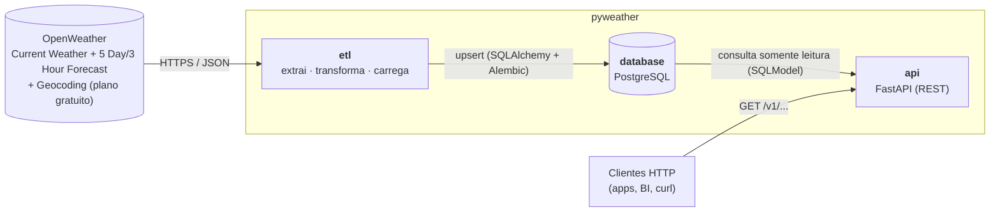
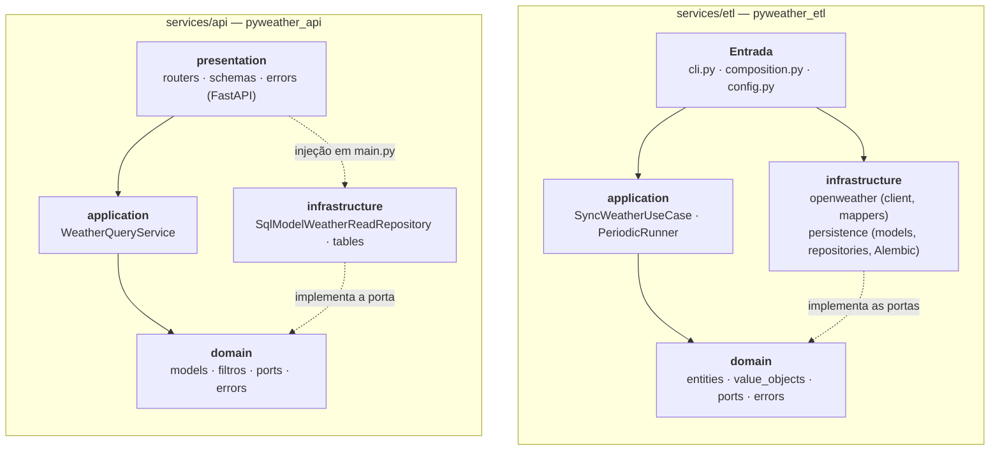
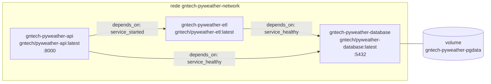

# 2. Arquitetura e design pattern

[← Índice](../../README.md) · Anterior: [1. Apresentação](01-apresentacao.md) · Próximo: [3. Domínio](03-dominio.md)

## Visão de contexto

Dois serviços independentes compartilham **apenas o banco de dados** (nenhum código em comum). O ETL
é o **único escritor** e dono do esquema; a API é **somente leitura**.

<!-- mmd:arquitetura-contexto -->

<!-- /mmd -->

## Design pattern: DDD com arquitetura hexagonal (portas e adaptadores)

Ambos os serviços aplicam **Domain-Driven Design** em quatro camadas, com a **regra de dependência
apontando para o domínio**: o domínio não conhece frameworks, HTTP nem banco.

<!-- mmd:arquitetura-camadas -->

<!-- /mmd -->

| Camada            | Responsabilidade                                                              | Exemplos |
|-------------------|-------------------------------------------------------------------------------|----------|
| **domain**        | Modelo do negócio puro: entidades, objetos de valor, erros e **portas** (interfaces abstratas). Sem dependências externas. | `Location`, `CurrentWeather`, `Coordinates`, `WeatherProvider`, `WeatherRepository` |
| **application**   | **Casos de uso** que orquestram o domínio por meio das portas; regras de aplicação. | `SyncWeatherUseCase`, `PeriodicRunner`, `WeatherQueryService` |
| **infrastructure**| **Adaptadores** que implementam as portas com tecnologia concreta.            | `OpenWeatherClient` (httpx), `SqlAlchemyWeatherRepository`, `SqlModelWeatherReadRepository` |
| **entrada** (ETL: `cli`/`composition`; API: `presentation`) | Traduz o mundo externo (linha de comando, HTTP) para os casos de uso e **monta as dependências**. | `cli.py`, `composition.py`, routers FastAPI, `schemas.py` |

Padrões empregados:

- **Entity / Value Object** — entidades têm identidade (`Location.id`); conceitos sem identidade
  (`Coordinates`, `Wind`, `Precipitation`) são `dataclass(frozen=True)` e validam invariantes na criação.
- **Repository** — `WeatherRepository` (escrita, ETL) e `WeatherReadRepository` (leitura, API) escondem o SQL.
- **Ports & Adapters** — `GeocodingProvider`/`WeatherProvider` permitem trocar a OpenWeather por
  outro provedor sem tocar no caso de uso; nos testes, usam-se *fakes* e `httpx.MockTransport`.
- **Anti-corruption layer** — `mappers.py` converte o JSON da OpenWeather em entidades **validadas**;
  dado malformado vira `PayloadError` e **nunca chega ao banco**.
- **Application Service / Use Case** — um caso de uso por intenção (`SyncWeatherUseCase.execute`).
- **Composition Root** — `composition.py` (ETL) e `main.create_app` (API) são os únicos lugares que
  conhecem as implementações concretas (injeção de dependências manual, sem *container*).
- **Specification simplificada (filtros)** — filtros imutáveis no domínio (`CurrentFilter`,
  `HourlyFilter`…) traduzidos para SQL somente na infraestrutura.

## Decisões de projeto

| Decisão | Motivo |
|---------|--------|
| **Cargas idempotentes** (`merge` por chave primária natural `(location_id, instante)`) | Reexecutar o ETL, ou reprocessar uma janela, atualiza o registro em vez de duplicá-lo. Previsões que mudam entre execuções são sobrescritas; `fetched_at` registra quando foram obtidas. |
| **ETL é dono do esquema** (Alembic, migração ao iniciar) | Evita duas fontes de verdade para o DDL. A API apenas espelha as tabelas (SQLModel) e nunca cria nem altera esquema. |
| **Datas sempre com fuso (UTC)** (`timestamptz`; `UtcDateTime` recusa datas ingênuas) | Elimina ambiguidades; a API devolve UTC em ISO 8601. O fuso local do lugar fica em `locations.timezone`/`timezone_offset`. |
| **Retentativas com recuo exponencial** para 429/5xx/falhas de rede; `Retry-After` respeitado (máx. 60 s) | Resiliência a limites e indisponibilidades; 401/404 **não** são repetidos. |
| **Segredos fora do código e dos logs** | A chave só trafega como parâmetro `appid`; os loggers `httpx`/`httpcore` são silenciados (as URLs contêm a chave); `SecretStr` evita vazar no `repr`. |
| **Proteção da paginação (`next`)** | A URL de próxima página só é seguida se o host for o configurado, evitando enviar a chave a terceiros. |
| **Busca textual com curingas escapados** | `%` e `_` informados pelo cliente são tratados como literais (sem varredura acidental). |
| **Paginação obrigatória** (`limit` ≤ 200) | Protege o banco e a rede; o corpo traz `total`, `limit` e `offset`. |
| **Erros de domínio → HTTP** num único ponto (`errors.py`) | 404 (local/dado inexistente), 422 (filtro inconsistente), 503 (banco indisponível no *readiness*). |
| **Imagens por serviço com dependências isoladas** (`uv sync --only-group`) | Cada imagem leva só o que usa (a do ETL não contém FastAPI; a da API não contém Alembic); usuário não-root. |

## Implantação (Docker Compose)

<!-- mmd:implantacao -->

<!-- /mmd -->

- O `etl` só inicia com o banco **saudável** (`pg_isready`) e, ao subir, **aplica as migrações**.
- A `api` espera o banco saudável e o `etl` **iniciado** (`service_started`).
- **Limitação conhecida:** `service_started` não garante que a migração já terminou. Na **primeira**
  subida, uma consulta feita nos primeiros segundos pode falhar com erro 500 (tabelas ainda
  inexistentes). O `/health/ready` verifica apenas a conectividade (`SELECT 1`), não a existência do
  esquema. Após a migração (segundos), tudo funciona normalmente.
- Dados persistem no volume `gntech-pyweather-pgdata`.
