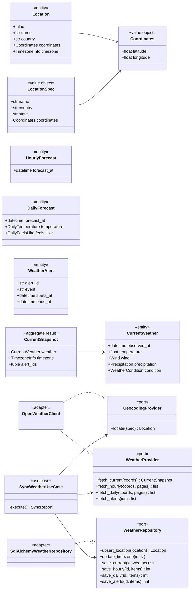
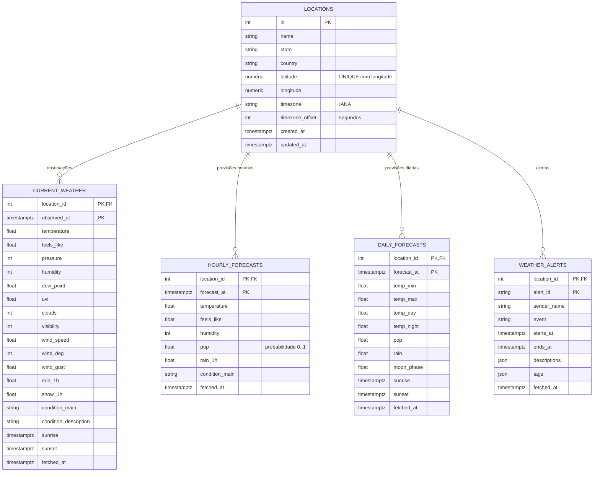

# 3. Modelagem de domínios e entidades

[← Índice](../../README.md) · Anterior: [2. Arquitetura](02-arquitetura.md) · Próximo: [4. Casos de uso](04-casos-de-uso.md)

## Linguagem ubíqua

| Termo | Significado |
|-------|-------------|
| **Local** (`Location`) | Cidade monitorada, identificada por coordenadas. |
| **Condições atuais** (`CurrentWeather`) | Observação do momento; o ETL acumula uma por instante, formando um **histórico**. |
| **Previsão horária / diária** | Projeção por hora / por dia fornecida pela OpenWeather. |
| **Alerta** (`WeatherAlert`) | Aviso oficial emitido por uma agência para um período. |
| **Extração** | Uma execução do ETL (`SyncReport`). |

## Domínio do ETL

<!-- mmd:dominio-classes-etl -->

<!-- /mmd -->

### Objetos de valor (imutáveis)

| Objeto | Campos | Invariantes |
|--------|--------|-------------|
| `Coordinates` | `latitude`, `longitude` | −90 ≤ lat ≤ 90; −180 ≤ lon ≤ 180 (`InvalidCoordinatesError`) |
| `LocationSpec` | `name`, `country`, `state?`, `coordinates?` | Se houver `coordinates`, a geocodificação é dispensada |
| `TimezoneInfo` | `name` (IANA), `offset_seconds` | — |
| `WeatherCondition` | `code`, `main`, `description`, `icon` | Primeira condição da lista `weather` |
| `Wind` | `speed`, `direction`, `gust` | m/s e graus |
| `Precipitation` | `rain`, `snow`, `probability` | mm/h; probabilidade de 0 a 1 |
| `DailyTemperature` / `DailyFeelsLike` | dia, mín., máx., noite, entardecer, manhã | — |
| `AlertDescription` | `language`, `text` | — |

### Entidades

| Entidade | Identidade | Observações |
|----------|------------|-------------|
| `Location` | `id` (atribuído na persistência); unicidade natural por coordenadas | Nome/estado/país são atualizados a cada extração |
| `CurrentWeather` | `(location, observed_at)` | Temperatura, sensação, pressão, umidade, UV, nuvens, visibilidade, vento, precipitação, condição, nascer/pôr do sol |
| `HourlyForecast` | `(location, forecast_at)` | Mesmos campos de `CurrentWeather` (exceto sol) + probabilidade de precipitação |
| `DailyForecast` | `(location, forecast_at)` | Temperaturas por período, chuva/neve, sol e **lua** (`moonrise`, `moonset`, `moon_phase`) |
| `WeatherAlert` | `(location, alert_id)` | Vigência (`starts_at`…`ends_at`), emissor, evento, textos por idioma, etiquetas |

`CurrentSnapshot` é o resultado da consulta de condições atuais: a observação, o fuso e os IDs de
alertas ativos (cujos detalhes são obtidos em chamadas separadas).

### Portas

| Porta | Implementação (infraestrutura) |
|-------|--------------------------------|
| `GeocodingProvider.locate` | `OpenWeatherClient` → `GET /geo/1.0/direct` |
| `WeatherProvider.fetch_current / fetch_hourly / fetch_daily / fetch_alerts` | `OpenWeatherClient` → `GET /data/4.0/onecall/{current, timeline/1h, timeline/1day, alert/{id}}` |
| `WeatherRepository.*` | `SqlAlchemyWeatherRepository` (`merge`/upsert por chave) |

### Erros do domínio (`PyWeatherError`)

`InvalidCoordinatesError`, `ConfigurationError`, `WeatherProviderError` ⟵ {`AuthenticationError` (401),
`RateLimitError` (429), `ProviderUnavailableError` (5xx/rede), `ResourceNotFoundError` (404),
`LocationNotFoundError`, `PayloadError`}.

## Modelo relacional (PostgreSQL)

<!-- mmd:dominio-er -->

<!-- /mmd -->

Pontos de modelagem:

- **Chaves primárias compostas naturais** `(location_id, instante)` tornam a carga idempotente e
  dispensam chaves substitutas nas séries temporais. Todas as tabelas filhas usam
  `ON DELETE CASCADE` para `locations`.
- `locations` tem restrição **única** em `(latitude, longitude)`; as coordenadas são `NUMERIC(9,6)`
  (~0,1 m) e arredondadas antes da gravação, para que a geocodificação repetida encontre o mesmo local.
- Todas as colunas de data/hora são `timestamptz` (UTC). `descriptions` e `tags` de alertas são `JSON`.
- Unidades seguem `OPENWEATHER_UNITS` (padrão `metric`: °C, m/s, hPa, mm). **O banco não guarda a
  unidade por registro**; mudar a configuração depois de acumular dados mistura unidades — nesse
  caso, use um banco novo ou converta o histórico.
- O esquema é versionado por migrações Alembic em
  `services/etl/pyweather_etl/infrastructure/persistence/migrations/versions/` (revisão `0001`).

## Domínio da API (leitura)

A API possui modelos de leitura próprios (`pyweather_api.domain.models`), propositalmente separados
das entidades do ETL: os serviços evoluem de forma independente e compartilham somente o contrato do
banco.

| Conceito | Descrição |
|----------|-----------|
| `Page[T]` | Itens + `total` + `limit` + `offset` |
| `Pagination` | `limit` (1–200, padrão 50) e `offset` |
| `TimeRange` | Intervalo `[start, end]` inclusivo e opcional |
| `LocationFilter` | `name`, `state` (trecho, sem distinção de maiúsculas), `country` (código exato) |
| `CurrentFilter` | período, temperatura mín./máx., umidade mín./máx., condição, ordem |
| `HourlyFilter` | período, temperatura mín./máx., prob. de precipitação mínima, condição, ordem |
| `DailyFilter` | período, mínima do dia ≥ X, máxima do dia ≤ Y, prob. mínima, condição, ordem |
| `AlertFilter` | evento, emissor, vigente em (`active_at`), ordem |

Regras de negócio da API (`WeatherQueryService`): o local deve existir (`LocationNotFoundError`);
o início do período não pode ser posterior ao fim e mínimos não podem exceder máximos
(`InvalidFilterError`); consultar a "condição atual" de um local ainda sem observações gera
`NoDataError`.
