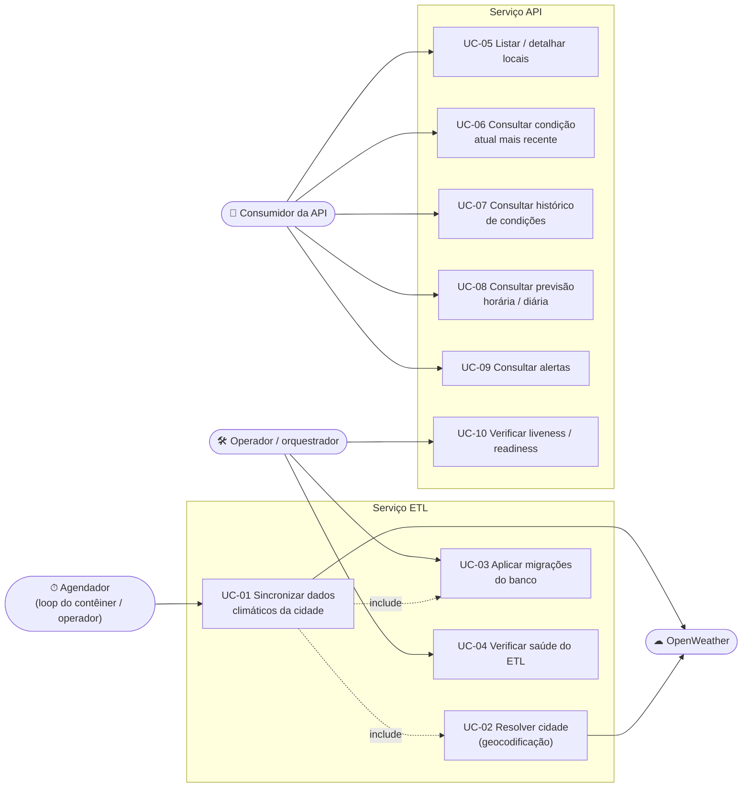

# 4. Casos de uso

[← Índice](../../README.md) · Anterior: [3. Domínio](03-dominio.md) · Próximo: [5. Sequências](05-sequencias.md)

## Atores

| Ator | Descrição |
|------|-----------|
| **Agendador** | O laço periódico do contêiner `etl` (`PeriodicRunner`), ou um operador executando `make etl-run`. |
| **Consumidor da API** | Qualquer cliente HTTP (aplicação, BI, `curl`). |
| **Operador / orquestrador** | Pessoa ou plataforma (Docker, Kubernetes) que migra o banco e verifica a saúde dos serviços. |
| **OpenWeather** | Sistema externo (APIs gratuitas: Geocoding, Current Weather e 5 Day / 3 Hour Forecast). |

## Diagrama

<!-- mmd:casos-de-uso -->

<!-- /mmd -->

## Descrição dos casos de uso

### Serviço ETL

| ID | Caso de uso | Ator | Fluxo principal | Alternativos / erros |
|----|-------------|------|-----------------|----------------------|
| **UC-01** | Sincronizar dados climáticos da cidade | Agendador | 1. Resolve e grava o local (UC-02). 2. Consulta condições atuais e grava (com o fuso). 3. Se `ETL_INCLUDE_FORECAST`, consulta a previsão de 5 dias, grava os passos de 3 h e o resumo diário derivado. 4. Devolve `SyncReport` (contagens). | Provedor indisponível/limitado → retentativas e, esgotadas, o erro é registrado e o laço tenta no próximo ciclo. 401 → `AuthenticationError`, sem retentativa. Payload inválido → `PayloadError`, nada é gravado daquela etapa. `OPENWEATHER_API_KEY` ausente → `ConfigurationError`. **Idempotente.** |
| **UC-02** | Resolver cidade (geocodificação) | (incluído em UC-01) | Se `CITY_LATITUDE/LONGITUDE` foram informadas, usa-as; senão consulta `/geo/1.0/direct` e faz *upsert* do local. Executado **uma única vez** por processo. | Cidade desconhecida → `LocationNotFoundError`. |
| **UC-03** | Aplicar migrações do banco | Operador | `make migrate` (ou implícito em `run`/`serve`) leva o banco à revisão mais recente do Alembic. | Reexecutar é inofensivo (idempotente). |
| **UC-04** | Verificar saúde do ETL | Operador | `python -m pyweather_etl healthcheck` retorna 0 se o banco está acessível **e** na última revisão (usado no `HEALTHCHECK` da imagem). | Banco inacessível ou desatualizado → código 1. |

### Serviço API

| ID | Caso de uso | Endpoint | Regras |
|----|-------------|----------|--------|
| **UC-05** | Listar / detalhar locais | `GET /v1/locations`, `GET /v1/locations/{id}` | Filtros por nome, estado, país; ordenação alfabética; 404 se o local não existir. |
| **UC-06** | Consultar a condição atual mais recente | `GET /v1/locations/{id}/current` | 404 se o local não existe **ou** ainda não há observações. |
| **UC-07** | Consultar histórico de condições | `GET /v1/locations/{id}/current/history` | Período, faixas de temperatura/umidade, condição; mais recente primeiro por padrão. |
| **UC-08** | Consultar previsão horária / diária | `GET /v1/locations/{id}/forecast/{hourly,daily}` | Período, temperatura, probabilidade de precipitação, condição; ordem cronológica por padrão. |
| **UC-09** | Consultar alertas | `GET /v1/locations/{id}/alerts` | Filtros por evento, emissor e vigência (`active_at`). |
| **UC-10** | Verificar *liveness* / *readiness* | `GET /health`, `GET /health/ready` | *Liveness* não consulta o banco; *readiness* faz `SELECT 1` e responde 503 se falhar. |

Em todas as consultas: parâmetros inválidos ou desconhecidos → **422**; filtros logicamente
inconsistentes (ex.: `start` > `end`) → **422** com mensagem em português.
