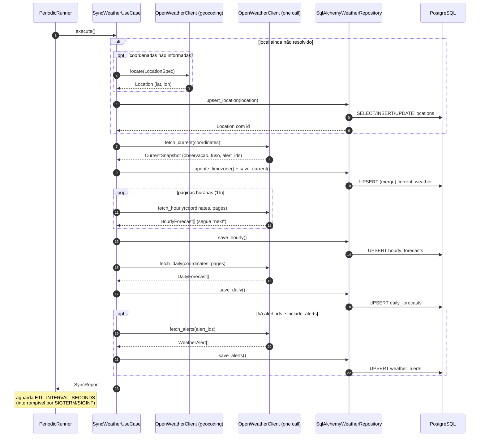
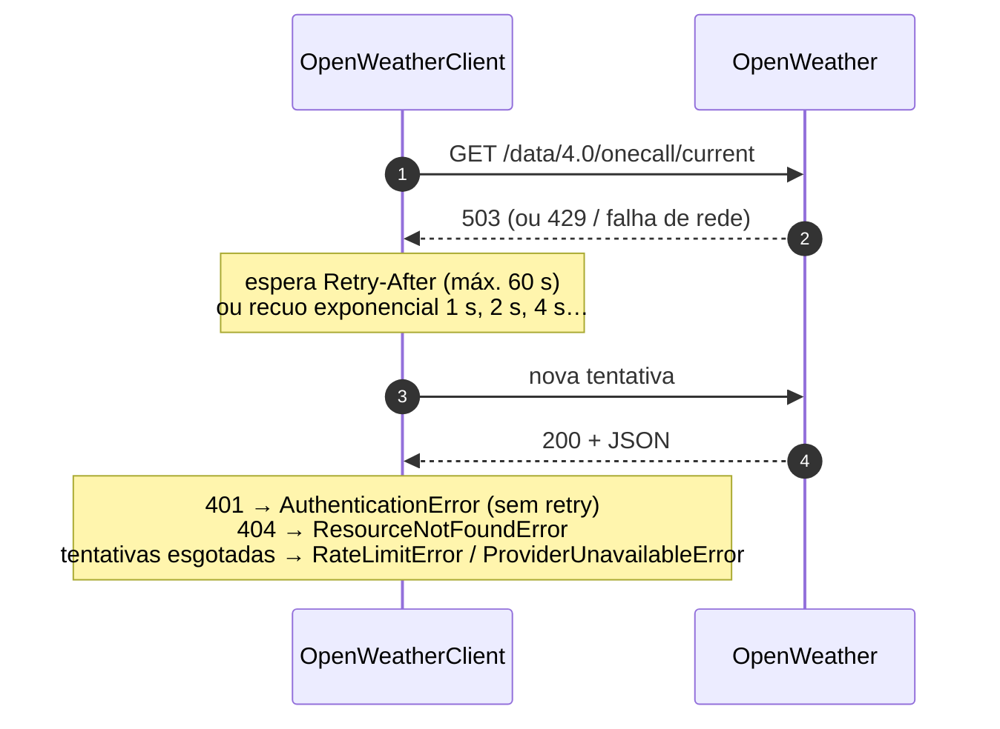
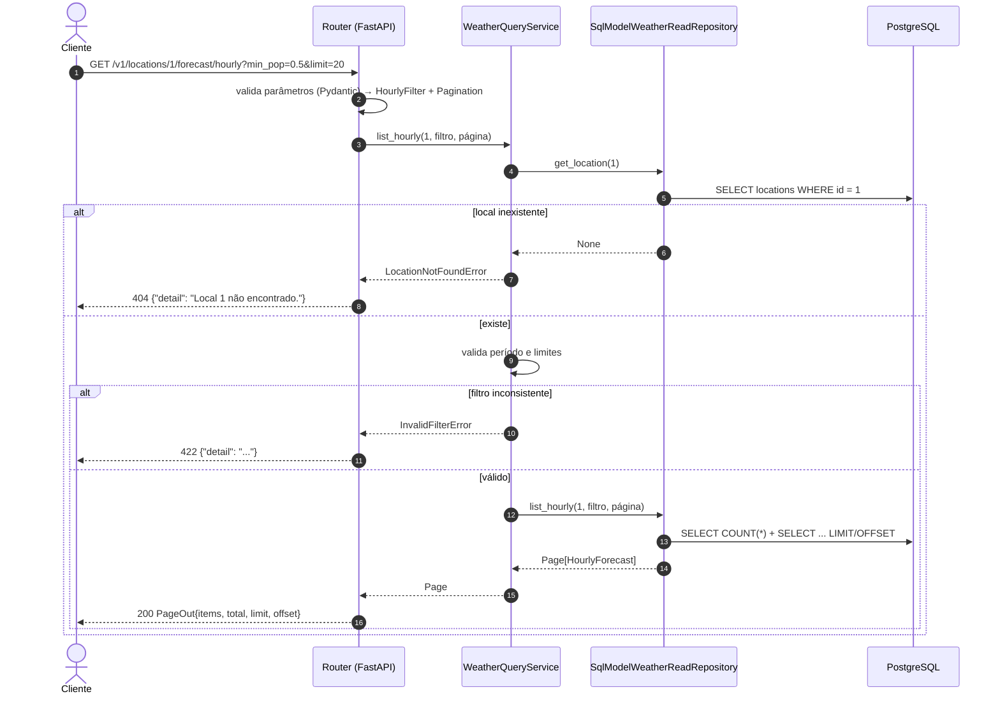

# 5. Sequências

[← Índice](../../README.md) · Anterior: [4. Casos de uso](04-casos-de-uso.md) · Próximo: [6. API](06-api.md)

## 5.1 Extração, transformação e carga (UC-01)

<!-- mmd:sequencia-etl -->

<!-- /mmd -->

Notas:

- O local é resolvido e gravado **uma vez** por processo; nas execuções seguintes reutiliza-se o `id`.
- Cada operação do repositório é uma **transação própria**; uma falha numa etapa (ex.: previsão
  diária) não desfaz o que já foi gravado em etapas anteriores — e como a carga é idempotente, a
  próxima execução completa o que faltou.
- As linhas do tempo são paginadas pela OpenWeather: o cliente segue o campo `next` até
  `ETL_HOURLY_PAGES` / `ETL_DAILY_PAGES` páginas (cada página é uma chamada à API) e descarta
  registros duplicados entre páginas.
- O `PeriodicRunner` captura exceções do ciclo (log com *stack trace*) e continua; `SIGTERM`/`SIGINT`
  interrompem a espera e encerram graciosamente após o ciclo corrente.

## 5.2 Tratamento de falhas na chamada à OpenWeather

<!-- mmd:sequencia-retry -->

<!-- /mmd -->

| Resposta | Comportamento |
|----------|---------------|
| 200 | Converte o JSON; formato inesperado → `PayloadError` |
| 401 | `AuthenticationError` imediato (chave inválida ou sem acesso ao produto) |
| 404 | `ResourceNotFoundError` (para alertas, é ignorado com *warning*) |
| 429, 500, 502, 503, 504, falha de rede | Até `HTTP_MAX_RETRIES` novas tentativas: espera `Retry-After` (limitado a 60 s) ou `1 s × 2ⁿ`; esgotadas → `RateLimitError` / `ProviderUnavailableError` |
| outros 4xx | `WeatherProviderError` |

## 5.3 Consulta pela API (UC-08)

<!-- mmd:sequencia-api -->

<!-- /mmd -->

Notas:

- A validação de **formato** (tipos, faixas, parâmetros desconhecidos) ocorre na borda (Pydantic →
  422 padrão do FastAPI); a validação de **regras** (período invertido, local inexistente) ocorre no
  serviço de aplicação e é traduzida em um único ponto (`presentation/api/errors.py`).
- A listagem faz duas consultas: `COUNT(*)` com os mesmos filtros (para `total`) e a página
  (`ORDER BY … LIMIT … OFFSET …`).
