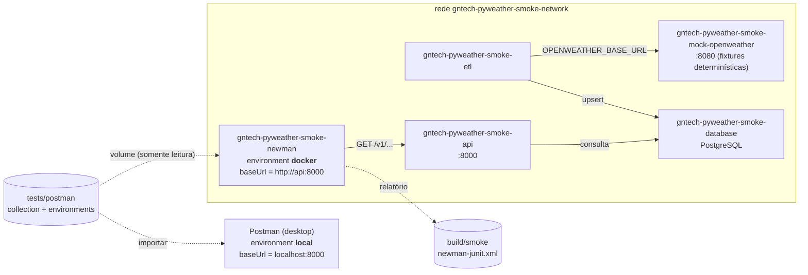
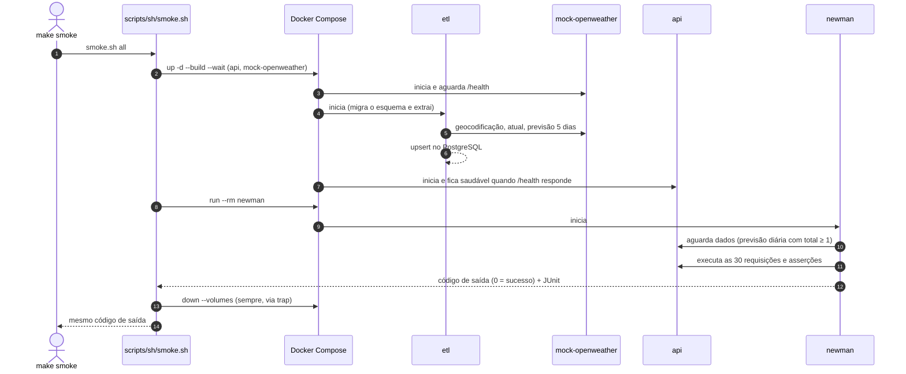

# 8. Testes de sanidade (smoke tests)

[← Índice](../../README.md) · Anterior: [7. Desenvolvimento e operação](07-desenvolvimento.md)

Os *smoke tests* verificam, **de ponta a ponta**, que a plataforma funciona integrada: ETL →
PostgreSQL → API, todos em contêineres, consumidos por requisições HTTP reais. Eles complementam os
testes unitários ([seção 7](07-desenvolvimento.md#qualidade)), que usam SQLite e respostas simuladas.

A mesma **collection do Postman** serve a dois usos: exploração manual (Postman) e execução
automatizada (Newman, dentro da rede do Docker Compose) — só muda o *environment*.

## Artefatos

| Caminho | Função |
|---------|--------|
| `tests/postman/pyweather.postman_collection.json` | Collection v2.1: 30 requisições em 7 pastas (saúde, locais, condições atuais, previsão horária, previsão diária, alertas, contrato OpenAPI) |
| `tests/postman/pyweather.local.postman_environment.json` | `baseUrl = http://localhost:8000`; `strict = false` (valida estrutura e contrato, com qualquer dado) |
| `tests/postman/pyweather.docker.postman_environment.json` | `baseUrl = http://api:8000` (nome do serviço na rede do Compose); `strict = true` (valida os valores exatos do mock) |
| `infra/docker/mock-openweather/` | Mock determinístico da OpenWeather gratuita (biblioteca padrão do Python) |
| `infra/docker/newman/` | Imagem `gntech/pyweather-newman:latest` (Node + Newman 6.2.1) e `run.sh` (espera os dados e executa) |
| `infra/docker/docker-compose.smoke.yml` | *Override* do Compose que monta a stack de smoke |
| `scripts/sh/smoke.sh` | Orquestra `up` → `run` → `down` |
| `.github/workflows/smoke.yml` | Executa `make smoke` no CI |

## Como funciona

<!-- mmd:smoke-implantacao -->

<!-- /mmd -->

1. **OpenWeather substituída por um mock.** O ETL do smoke aponta `OPENWEATHER_BASE_URL` para
   `http://mock-openweather:8080`, com a chave fictícia `smoke-test-key`. Não exige chave real, rede
   externa nem consome cota, e os dados são **previsíveis** (Florianópolis, 24,5 °C, 40 passos de 3 h
   — 20 com `pop ≥ 0,5` —, resumo de 5 ou 6 dias civis e nenhum alerta), o que permite asserções
   exatas. Os horários das fixtures são relativos ao instante da execução (por isso o número de
   dias é 5 ou 6, conforme o horário em que o teste roda).
2. **Isolamento.** O projeto Compose é `gntech-pyweather-smoke`: contêineres, rede e volume próprios
   (`gntech-pyweather-smoke-*`), **nenhuma porta publicada no host** e banco sempre novo, destruído ao
   final. Não conflita com a stack de desenvolvimento (`make up`) nem apaga seus dados.
3. **Mesma collection, host diferente.** Dentro do Compose o Newman usa o environment `docker`
   (`http://api:8000`); no desktop você importa o environment `local` (`http://localhost:8000`).
4. **Modo estrito.** A variável `strict` do environment liga as asserções de valor (ex.:
   `expectedTemperature`, `expectedHourlyTotal`). Contra dados reais (`strict = false`) a collection
   valida apenas estrutura, tipos, filtros, paginação, erros e o contrato OpenAPI.
5. **Prontidão.** O `run.sh` aguarda até 180 s (`WAIT_TIMEOUT`) que `/v1/locations/1/forecast/daily`
   retorne `total ≥ 1` — o ETL grava por último o resumo diário, então todos os dados já estão
   disponíveis — e só então executa o Newman. Isso elimina a corrida entre a subida da API e a primeira extração.

<!-- mmd:smoke-fluxo -->

<!-- /mmd -->

## Executando

```bash
make smoke          # sobe tudo, executa a collection e derruba (código de saída = resultado)
```

Requer Docker Compose ≥ 2.24 (o mesmo do restante do projeto). Passos individuais, úteis para depurar:

| Comando | O que faz |
|---------|-----------|
| `make smoke-up` | Sobe `database`, `mock-openweather`, `etl` e `api` |
| `make smoke-run` | Executa o Newman na rede do Compose |
| `make smoke-logs` | Logs de todos os serviços |
| `make smoke-down` | Derruba a stack e remove o volume |
| `make smoke-local` | Collection + environment `local` via `npx newman` (API em `localhost:8000`, ex.: `make up`) |

`make smoke` **sempre** derruba a stack ao terminar (mesmo em falha ou Ctrl+C) e, em caso de falha,
imprime os logs dos serviços. O relatório JUnit fica em `build/smoke/newman-junit.xml` (no CI, é
publicado como artefato).

> O Newman roda como o usuário `node` (UID 1000) no contêiner, e `build/smoke` é montado do host. O
> `smoke.sh` libera a escrita nesse diretório (`chmod a+rwx`) para evitar `EACCES` quando o dono no
> host tem outro UID (como no runner do GitHub Actions, UID 1001).

### No Postman (desktop)

1. *Import* → `tests/postman/pyweather.postman_collection.json` e o environment desejado.
2. Selecione o environment (`pyweather — local`) e suba a API (`make up` ou `make api-dev`).
3. Execute requisições individuais ou o *Collection Runner*. A variável `locationId` é preenchida
   automaticamente pela requisição de listagem de locais.

### Contra dados reais

Com a stack de desenvolvimento no ar (`make up`, com chave real), `make smoke-local` valida a API
com `strict = false`. Os valores exatos do mock **não** se aplicam.

## Limitações

- O ambiente em que este recurso foi desenvolvido **não tem *daemon* Docker**: as imagens
  `mock-openweather` e `newman` e a stack `make smoke` **não foram construídas nem executadas** ali.
  O que foi verificado: `docker compose config` (sintaxe do override) e a execução **real** de
  mock → ETL → banco → API → Newman, fora de contêineres (81 asserções no modo estrito e 73 no
  `local`, 0 falhas; falhas forçadas retornam código 1). Após a migração para o plano gratuito essa
  verificação usou SQLite; o esquema não mudou e a versão anterior havia sido verificada em
  PostgreSQL real. Rode `make smoke` na
  primeira utilização.
- O mock reproduz o contrato documentado da OpenWeather gratuita, não o seu comportamento real; ele não
  substitui um teste com a API de verdade.
